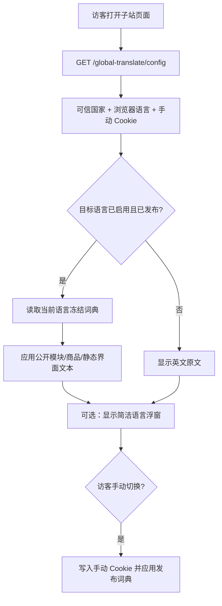

# LONGOS 全球翻译 v1.12.0：竞品调研、IP 自动本地化与语言浮窗优化

## 1. 项目与目标

LONGOS 是多子站、多品类 SaaS 建站程序。本次基于完整 v1.11.0 插件源码升级，继续保留已经实现的翻译任务、人工译文保护、翻译库维护、服务商删除、硅基流动多免费模型及 RPM/TPM 限流功能。

**这次的重点不是前端实时调用 AI**，而是将已经审核、发布的本地词典准确呈现给访客。SEO 元数据继续不进入翻译范围；装修模块仍按当前实际使用、实际展示的字段增量扫描，新模块需重新扫描与翻译。

## 2. 独立站成熟方案对标（官方资料）

| 产品 | 值得学习的机制 | LONGOS v1.12.0 的采用方式 | 不照搬的部分 |
| --- | --- | --- | --- |
| Shopify Translate & Adapt | 已翻译内容自动同步；尽量保留人工编辑 | 继续使用 source hash、冻结发布版本和人工锁定保护 | 不复制其按店铺国家限制自动翻译语言数量的商业配额 |
| Shopify Markets | 依地区与浏览器偏好本地化，保存手动选择 | 可信 IP/地区 → 国家规则 → 多语言国家浏览器辅助 → 有效发布词典；手动 Cookie 优先 | 不修改货币、付款、配送市场和 URL 域名，也不伪造国家切换 |
| WPML | 浏览器语言建议、记住用户语言、可配置选择器 | 仅启用已发布语言的选择器，手动选择保存 90 天 | 不未经授权重定向用户 URL，也不覆盖 SEO 元数据 |
| Weglot | 访客自动语言切换、简洁语言选择器、首访性能 | 小型悬浮选择器、动态模块重应用、浏览器本地缓存发布译文 | 不让前端对网页内容直接调用第三方翻译 API |
| SHOPYY | 多语言功能、IP 本地化设置 | 依可信地区判定并套用站点已发布词典 | 不把显示翻译和货币、客户 IP 风险或订阅插件捆绑 |

来源：

- Shopify 官方自动翻译：https://help.shopify.com/en/manual/international/languages/translate-adapt-app/automatic-translation
- Shopify 官方地区自动重定向：https://help.shopify.com/en/manual/international/automatic-redirection
- Shopify 官方地区本地化：https://help.shopify.com/en/manual/markets/getting-started/localization
- WPML 官方浏览器语言切换：https://wpml.org/documentation/getting-started-guide/language-setup/automatic-redirect-based-on-browser-language/
- Weglot 官方自动切换：https://support.weglot.com/article/97-how-can-automatically-redirect-visitors-to-own-language
- SHOPYY 官方本土化设置：https://www.shopyy.com/article/8880.html
- SHOPYY 官网多语言功能：https://www.shopyy.com/article/8367.html

## 3. 已找到并修复的插件问题

| 问题 | 旧版行为与风险 | v1.12.0 改动 |
| --- | --- | --- |
| 将可视按钮与自动翻译绑定 | `widget.enabled=false` 时，前端注册、字典接口及部分产品变体/支付页翻译一起被关闭 | `TranslationSettings::presentationActive()` 统一判断自动地区匹配、浏览器回退及浮窗；按钮可隐藏但翻译引擎继续工作 |
| 将 IP 语言写入 HTML | CDN/整页缓存可能复用别的访客的 `country`、locale、Cookie 判断 | 移除请求相关的内嵌 JSON，改为每次请求私有、`no-store` 的 `GET /global-translate/config`，HTML 可以继续按站点缓存 |
| 自动选中未发布语言 | 按国家选择语言后，网页又退回英文或出现错乱 | 先查找**当前启用且包含发布条目**的语言，再执行选择策略；未发布语言不能被自动选中 |
| 加拿大、瑞士、比利时等一国多语言 | 过去可能直接将加拿大当作法语、比利时当作法语 | 加入多语言国家候选列表；优先匹配该国合理候选中的浏览器语言，否则采用保守默认；后台显式国家规则仍具有最高地区优先级 |
| 前端版本停留旧版本 | 旧 `widget.js` / CSS 带 `1.5.7` 查询参数，后端已升级到 v1.11 | 静态资源和后端版本统一为 `1.12.0`；自检同时验证实际发布的 JS 与 CSS |
| 浮窗内容复杂且无意义 | 显示未发布的禁用语言、大块描述、图形“Aあ”，缺少过滤和清晰选中态 | 只展示源语言与已发布语言、原生语种名称、自动模式和当前语言；超过 7 种可搜索；支持外部点击和 Escape 关闭 |
| 动态加载的新装修组件 | 首次 DOM 翻译完成后，后加载的公开组件可能留在英文 | `MutationObserver` 仅对新插入的 `[data-lgt-root]`、`[data-lgt-field]`、`[data-lgt-richtext]` 做节流重应用；不在浏览器调用翻译服务商 |
| 容错与提示不准确 | 当前页面没有匹配词条就错误显示 EN，即使语言已发布且偏好已保存 | 区分**发布语言可用**与**当前页面命中词条**；保留访客选择并明确提示页面局部尚无译文 |

## 4. 语言判定的真实顺序

1. 完整的、已发布的**用户手动选择 Cookie**（有效期 90 天，HTTPS/HttpOnly/SameSite）优先。
2. `geo_auto_switch_enabled=true` 时，优先读取 LONGOS 的可信访客国家来源；若不可用，且部署了可用的 GeoIP2 本地数据库，使用真实访客 IP 离线解析。
3. 如果后台有该国家的**显式启用规则**且其语言已发布，采用显式规则。
4. 对加拿大（EN/FR）、比利时（NL/FR/DE）、瑞士（DE/FR/IT）、新加坡（EN/简中）、香港（繁中/EN）和卢森堡（FR/DE），仅在该国候选语言内参考浏览器 `Accept-Language`；未匹配时按保守默认顺序。
5. 其它国家采用内置映射（例如 FR→法语、DE→德语、JP→日语、CN→简体中文），前提是**该语言确已发布**。
6. 若国家未知或没有可用词典，且后台启用了浏览器语言回退，则从浏览器语言与可用发布语言的交集中选择。
7. 仍无可用语言则显示英文原文。不调用 AI，不伪造自动翻译完成状态。

**重要**：IP 只能大致推断国家，无法可靠推断每个人的首选语言；手动选择始终优先，尤其适用于移民、旅游者、多语言国家与使用 VPN 的用户。

## 5. 数据与请求流

- `/config` 是每位访问者独立的 HTTP 响应，返回 `Cache-Control: private, no-store`，不会包含原始 IP、客户信息或 API 密钥。
- `widget.enabled` **只控制浮窗的显示**。地区自动显示与浏览器语言回退可独立运行。
- 正文与静态界面始终读取当前子站的审核发布词典，按 revision/host/locale 使用 `sessionStorage` 缓存公共词条。
- 商品价格、货币、SKU、顾客信息、地址、输入表单、订单和支付内容原来的安全边界保持不变。

## 6. IP 来源的部署要求

仅靠插件源码不能凭空知道访客国家，必须具备可信的 IP 归属数据来源：

- **优先**：LONGOS 宿主已有的 `Beike\Services\VisitorCurrencyService::countryCode()`；请确认其服务端代理/边缘 IP 识别已配置，并能返回两位 ISO 国家代码。
- **可选离线回退**：若安装了 `GeoIp2\Database\Reader` 库、部署了合法获取且持续更新的 GeoIP2 国家数据库，可以通过应用配置 `longos.translation.geoip_db_path` 指向本机只读 `.mmdb` 数据库。插件不会自行下载 IP 库或对外发送访客 IP。
- **不要**直接信任访客任意传入的 `X-Country`、`CF-IPCountry`、`X-Forwarded-For`：只有可信反向代理链正确设置后，宿主生成的地理位置才可信。
- **必须测 CDN**：访问相同 URL 的法国、德国、日本访客，要分别取得自己的 `/config`，不能把 HTML 缓存中的地区决定强加给别人。
- **不会强制改价**：本地化与币种、支付、运费、税率、收货地区保持分离。

## 7. 开发与部署验收

1. 安全备份生产插件和数据库；先在预发布替换完整 `LongosGlobalTranslate/`，按 v1.11.0 及以前的迁移链检查安装状态（v1.12.0 没有新增迁移）。
2. 重新发布 `Static/public/widget.js` 与 `Static/public/widget.css` 到 `public/plugin/longos_global_translate/`，确认 CSS、JS 哈希均与源码一致；清理 CDN 和 Laravel 视图/静态缓存。此步骤不能只用 ZIP 覆盖代替。
3. 在后台开启已发布语言的「根据 IP 自动应用语言」。即使前端选择器开关处于**关闭**，首次法国 IP 用户若有 FR 译文也应看到法语。
4. 直接访问站点的 `/global-translate/config` 并确认返回：`country=FR`、`locale=fr`、`locale_source=geo_catalog/geo_rule`（具体字段根据配置）。响应必须 `private, no-store`。
5. 对法国与德国两个独立访问环境的同一 URL 测试 CDN；登录者、机器人和普通匿名用户不应复用错误国家数据。
6. 在加拿大测试浏览器首选 FR vs EN；若 FR 已发布但 EN 为商家源语言，应分别得到 FR/EN。禁用 FR 发布版本后，不能仍强行将访客设置为 FR。
7. 手动切换 JA，刷新、切换商品详情与分类页，90 天 Cookie 应保持 JA，不被当前 IP 改写。点击 Automatic 后，清除手动偏好并在下一次请求按 IP 重新决定。
8. 关闭悬浮按钮但保留 IP 自动语言规则；确认商品、公开装修组件、固定结账标签继续从本地字典呈现。
9. 动态插入一个已经翻译和发布、带 `data-lgt-*` 标记的装修模块；应自动应用译文，无新增服务商调用。新增**未翻译**模块应继续显示原文，重新扫描、翻译、发布后才有译文。
10. 查看移动端悬浮按钮、屏幕安全区、与客服窗口的遮挡情况；检查只显示已发布语言、`Escape`/外部点击关闭及键盘可达性。
11. 检查 `/global-translate/config` 限流（300 次/分钟/IP）、字典接口的较严格限流（60 次/分钟/IP）及 JS/CSS 发布哈希诊断。
12. 用 Chrome DevTools Network 确认任何浏览器页面都没有直接访问硅基流动/DeepL/Google 等外部翻译模型；只通过本站私有配置、公开发布词典和保存偏好接口交互。

## 8. 已知边界与进一步工作

- **当前没有完整 Laravel / LONGOS / PHP runtime**，本环境只能执行 Node 静态契约、JS 语法及 ZIP 校验。以上 IP 分流、CDN、GeoIP2、浏览器 DOM、移动端布局和数据库运行时行为仍须在预发布环境按测试矩阵验证。
- IP 国家来源为空时，且没有可用离线 GeoIP2 数据库，**无法保证 IP 自动翻译生效**；如管理员允许，可退回浏览器语言，否则保留英文。不会假称已经识别了国家。
- 已发布的前端客户端文本替换不等同于 SEO 语言路径/服务端多语言页面。按商家的要求，本次不翻译 SEO 元数据、不自动创建 `/fr/` 子目录、不修改 canonical/hreflang。
- 若专有主题没有渲染 `[data-lgt-*]`、没有商品链接实体或没有正确注入 `layout.master.footer.code`，插件不能仅通过猜测 DOM 安全地识别所有商家内容；需为该主题补充公开实体/字段标记。
- 多租户必须使用自己的设置、词典和发布版本；多站点共享外部硅基流动账户的**平台级限流**仍是独立后续任务，不在此版本宣称解决。

## 9. 变更文件索引

- `Services/PresentationLocaleResolver.php`：已发布语言约束、自动国家选择、多语言国家优先级、可选离线 GeoIP2。
- `Services/CountryLocaleCatalog.php`：国家候选语言，不再把所有多语言国家硬压成一个语种。
- `Services/StorefrontPresentationConfig.php`：独立浮窗可见性、配置字段、模型前后端版本同步。
- `Services/TranslationSettings.php`：展示开关与自动本地化开关分离。
- `Controllers/ShopTranslationController.php`、`Routes/shop.php`：独立访问者配置与发布词典 API。
- `Bootstrap.php`、`Views/shop/widget.blade.php`、`Static/public/widget.js`、`Static/public/widget.css`：无内联私人地区决定、每页无缓存配置、浮窗简化、动态模块重应用。
- `Services/PublishedProductVariantLocalizer.php`、`Services/PlatformPaymentLocaleBridge.php`：隐藏浮窗时也支持已发布字典。
- `Services/LocaleCoverageService.php`、`Controllers/AdminTranslationController.php`、`Views/admin/index.blade.php`：一致的展示诊断、CSS/JS 资源同步自检。
